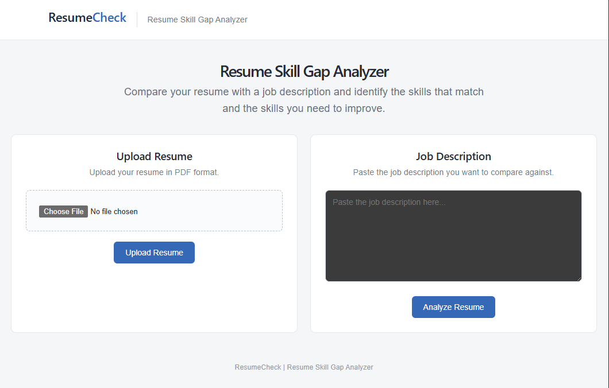
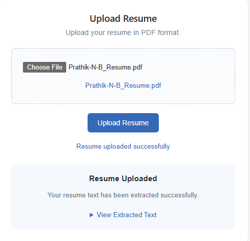
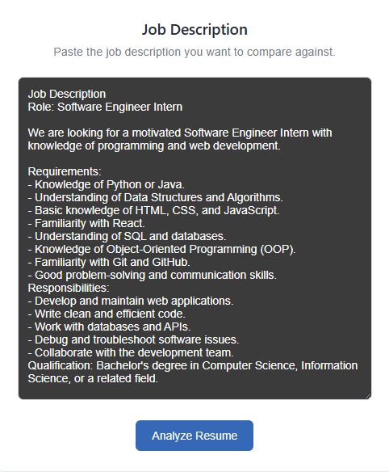
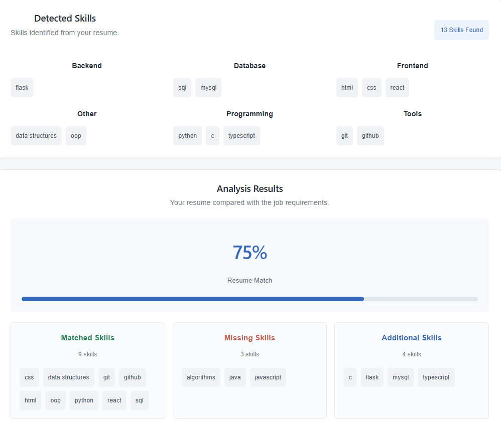

# Resume Skill Gap Analyzer

A web-based application that analyzes resumes against job descriptions to identify matching skills, missing skills, and additional skills. It helps job seekers understand how well their resumes align with specific job requirements and identify areas for improvement.

## Features

- **Resume Upload:** Upload resumes in PDF format.
- **Text Extraction:** Extract text from uploaded PDF resumes.
- **Skill Extraction:** Automatically identify technical skills from resumes using a predefined skill database.
- **Job Description Analysis:** Extract required skills from a given job description.
- **Skill Matching:** Compare resume skills with job requirements.
- **Match Score:** Calculate a percentage-based score representing how closely the resume matches the job description.
- **Skill Gap Identification:** Display matched, missing, and additional skills.
- **Interactive Dashboard:** View analysis results through a simple and user-friendly interface.

## Application Screenshots

### Home Page
<p align="center">
  
</p>

### Resume Upload and Job Description

<table border="0" width="100%">
  <tr>
    <td align="center" width="50%">
      
      <br><b>Resume Upload</b>
    </td>
    <td align="center" width="50%">
      
      <br><b>Job Description</b>
    </td>
  </tr>
</table>

### Skill Gap Analysis
<p align="center">
  
</p>
## Technology Stack

### Frontend
- React.js
- Vite
- JavaScript
- CSS

### Backend
- Python
- Flask
- Flask-CORS
- PyMuPDF

### Tools
- Visual Studio Code
- Git
- GitHub

## Project Structure

```text
Resume-Skill-Gap-Analyzer/
│
├── backend/
│   ├── app.py
│   ├── parser.py
│   ├── skill_extractor.py
│   ├── analyzer.py
│   └── skills.json
│
├── frontend/
│   ├── public/
│   ├── src/
│   │   ├── App.jsx
│   │   ├── App.css
│   │   ├── index.css
│   │   └── main.jsx
│   ├── package.json
│   └── vite.config.js
│
├── .gitignore
└── README.md
```

## Installation and Setup

Follow these steps to run the project locally.

### 1. Clone the Repository

```bash
git clone https://github.com/Prathik-N-B/Resume-Skill-Gap-Analyzer.git
```

```bash
cd Resume-Skill-Gap-Analyzer
```

### 2. Backend Setup

Navigate to the backend directory:

```bash
cd backend
```

Create and activate a Python virtual environment from the project root:

```powershell
cd ..
python -m venv .venv
.\.venv\Scripts\Activate.ps1
```

Install the required Python packages:

```bash
pip install Flask Flask-Cors PyMuPDF
```

Start the Flask backend:

```powershell
cd backend
python app.py
```

The backend will run at:

`http://127.0.0.1:5000`

### 3. Frontend Setup

Open another terminal and navigate to the frontend directory:

```bash
cd frontend
```

Install dependencies:

```bash
npm install
```

Start the development server:

```bash
npm run dev
```

The frontend will run at:

`http://localhost:5173`

## How It Works

1. Upload a resume in PDF format.
2. The backend extracts the text from the uploaded resume using PyMuPDF.
3. The skill extraction module identifies relevant technical skills using a predefined skill database.
4. Enter a job description for the desired role.
5. The application extracts the required skills from the job description.
6. The analyzer compares the extracted resume skills with the job requirements.
7. The application calculates a match percentage and displays:
   - **Matched Skills:** Skills present in both the resume and job description.
   - **Missing Skills:** Skills required by the job description but absent from the resume.
   - **Additional Skills:** Skills found in the resume but not required by the job description.

## Skill Categories

The skill database includes categories such as:

- Programming Languages
- Frontend Development
- Backend Development
- Databases
- Tools and Technologies
- Data Science and Artificial Intelligence
- Computer Science Fundamentals

## Future Enhancements

- Integration with AI-based skill extraction.
- Support for additional resume formats such as DOCX.
- Expanded skill database and job-role-specific skill recommendations.
- Resume improvement suggestions.
- Resume parsing and analysis using NLP techniques.
- Deployment for public access.

## Author

**Prathik N B**

Information Science and Engineering

[GitHub Profile](https://github.com/Prathik-N-B)

---

If you find this project useful, consider giving the repository a ⭐.